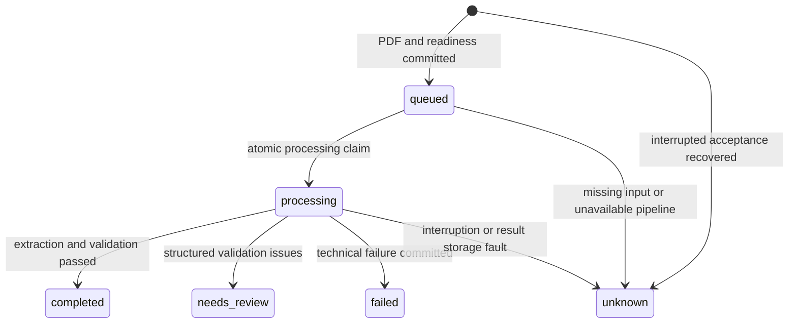

# Durable extraction API handoff

This contract belongs to feature/extraction-jobs, based on reviewed
chore/render-predeploy 4e5cad9ccbec0cc5261233f15a753e031e7c4d7b. It implements
technical extraction jobs only. No Render service or live integration was created.
See TASKS.md for actual offline verification and delivery provenance.

## Ownership and credentials

The expense application authenticates employees and authorizes document access
before every job creation or proxied query. It owns employee identity, confirmed
expense versions, approvals, budgets, recipients and payments. This service owns
technical processing records and extracted snapshots; completed is not approval.
Never infer an employee, project, recipient, eligibility or payer from a PDF.

Call these routes only from authenticated application server functions over
HTTPS. Send X-API-Key containing the server-only EXTRACTION_API_KEY. Do not put
this key in the browser, URL, multipart fields, logs or repository. APP_API_KEY
continues to authorize only the legacy receipt APIs; the two credentials must
differ. There is no caller-controlled employee or integration scope parameter.

EXTRACTION_INTEGRATION_SCOPE is a stable server-configured integration identifier,
independent of credentials. The database binds to it at initialization. Rotate
EXTRACTION_API_KEY while retaining scope and DATA_DIR to retain access and
idempotency. A scope change against the same store fails startup. This API trusts
one integration, not individual employees; a UUID is not an access-control rule.
Enforce employee ownership in the application database and never proxy arbitrary
request IDs supplied by a browser without checking that ownership.

## Requests and status codes

The application must generate and persist a canonical lowercase hyphenated UUID
as request_id before its first POST. Persist its association with the authorized
employee/document/version and exact PDF bytes or digest. Use the same UUID as
Idempotency-Key. No server-generated job identifier needs to be recovered from
the POST response. Canonical UUIDs are required; UUID versions are not restricted.

```http
POST /api/v1/extractions HTTP/1.1
X-API-Key: <server-only extraction credential>
Idempotency-Key: 17311111-2222-4333-8444-555555555555
Content-Type: multipart/form-data; boundary=example

--example
Content-Disposition: form-data; name="file"; filename="receipt.pdf"
Content-Type: application/pdf

<original PDF bytes>
--example--
```

The multipart form must contain exactly one field named file and no other
fields. Filename is ignored for extraction configuration and storage paths.
The same PDF admission as legacy receipts applies: PDF/octet-stream media type,
PDF header, strict readable unencrypted structure and at least one page.
MAX_UPLOAD_BYTES and MAX_PDF_PAGES apply, including to retries. The actual total
multipart body is bounded at MAX_UPLOAD_BYTES + 65536 regardless of Content-Length.
Oversized bodies can be rejected before authentication. Admission is not a
malicious-PDF CPU/memory sandbox or an ingress/upload deadline.

POST returns 202 after the original PDF and queued state are committed, or for
an identical retry still queued/processing. It does not await extraction.
An identical retry with completed/needs_review/failed/unknown returns 200 and
the stored snapshot, without another model call. Content identity is the actual
SHA-256 of every PDF byte: changed metadata/bytes also count as changed input.
Different keys do not share results, even for identical PDF hashes.

```http
GET /api/v1/extractions/17311111-2222-4333-8444-555555555555 HTTP/1.1
X-API-Key: <server-only extraction credential>
```

GET returns 200 for every published job state, including failures and unfinished
work, and never triggers extraction, validation, sync or retry. Unknown request
IDs return 404. A request still writing its initial input has an unpublished
internal reservation: GET can return 404 before its readiness commit. A 404
therefore NEVER proves that a prior uncertain POST cannot still finish.

Both success responses have Cache-Control: no-store. The application should
also avoid caching sensitive proxy responses.

| HTTP | detail.code / meaning |
| --- | --- |
| 400 | invalid_request_id for missing/noncanonical Idempotency-Key or GET ID; empty_file; framework malformed multipart |
| 401 | unauthorized: missing/wrong dedicated X-API-Key |
| 404 | not_found: no published job visible in this configured scope yet |
| 409 | content_conflict: key already reserved for different PDF bytes; never overwrite it |
| 413 | file_too_large, too_many_pages, request_too_large |
| 415 | unsupported_media_type: media or PDF header rejected |
| 422 | invalid_pdf, encrypted_pdf, invalid_form; framework missing/invalid file parameter |
| 429 | capacity_exceeded; Retry-After: 5; known identical keys still resolve at capacity |
| 503 | feature_disabled, or storage_unavailable with outcome=unknown; do not infer rejection |
| 500 / connection loss / proxy timeout | Unexpected or transport failure; acceptance/outcome remains uncertain |

Application errors use {"detail":{"code":"...","message":"..."}}; framework
400/422 responses may use their native detail structure. Technical job failures
are ordinary GET 200 / terminal duplicate POST 200 envelopes, not HTTP 502.
Enabled invalid configuration fails process startup; it does not start with a
partially working job feature. /health remains the existing unauthenticated
liveness check, not a worker-progress or external-connectivity guarantee.

## One persisted envelope

An initial accepted response (all timestamps are UTC) has this shape:

```json
{
  "request_id": "17311111-2222-4333-8444-555555555555",
  "status": "queued",
  "created_at": "2026-11-04T21:00:00+00:00",
  "updated_at": "2026-11-04T21:00:00+00:00",
  "data": null,
  "validation": null,
  "error": null,
  "extraction_version": {
    "pipeline_version": "receipt-extraction-v1",
    "pipeline_sha256": "<64 lowercase hexadecimal characters>",
    "model": "<model selected at first acceptance>",
    "prompt_sha256": "<64 lowercase hexadecimal characters>",
    "schema_sha256": "<64 lowercase hexadecimal characters>",
    "request_timeout_seconds": 120.0,
    "max_output_tokens": 4096
  }
}
```

Hash placeholders above are explanatory strings; actual responses contain the
computed SHA-256 values. A completed envelope retains those identifiers,
created_at and extraction_version, updates updated_at, and contains, for example:

```json
{
  "status": "completed",
  "data": {
    "merchant": "Fictional Stationery",
    "date": "2026-10-01",
    "receipt_number": "F-123",
    "currency": "CAD",
    "total": "12.30",
    "subtotal": "12.30",
    "tax": null,
    "tip": null,
    "discount": "0.00",
    "items": [
      {"description": "Fictional pen", "quantity": "1.000", "unit_price": "2.30", "amount": "2.30"},
      {"description": "Fictional notebook", "quantity": null, "unit_price": null, "amount": "10.00"}
    ]
  },
  "validation": {"passed": true, "issues": []},
  "error": null
}
```

This second JSON shows only the changing fields; the full response always
includes all eight top-level fields. The canonical ReceiptData and
ValidationResult models are reused from app/schemas/receipt.py. Preserve every
item, null, decimal string and structured issue. Never parse money through a
floating-point number. Null optional arithmetic components are not inferred as
zero: completed means required fields and applicable deterministic checks passed,
not that all possible arithmetic relationships were verifiable.

| State | Meaning and response fields |
| --- | --- |
| queued | Durable associated input is ready; data/validation/error are null |
| processing | Processing reservation committed before dispatch; data/validation/error are null |
| completed | Structured extraction and receipt-level validation passed; full data/validation, null error |
| needs_review | Structured data exists and validation found issues; full data/validation, null error |
| failed | Terminal technical extraction/validation-execution failure; null data/validation, sanitized error |
| unknown | Interrupted or uncertain acceptance/processing/storage, missing input or unavailable pipeline; no usable result assumed, null data/validation, sanitized error; controlled recovery required |

needs_review preserves, for example, an issue object with code=missing_currency,
field=currency and message="Required field currency is missing"; data.currency
remains null. failed can have error={"code":"extraction_failed",
"message":"Extraction could not be completed"}. unknown can have
error={"code":"interrupted_processing","message":"Processing is uncertain;
controlled operator recovery is required"}. Do not infer business validation
issues from technical failures.



All four terminal states are sticky. No automatic resend or public reset/retry
endpoint exists. Internal raw model output, normalization events, available SDK
metadata and recovery codes remain in the job record. Responses expose none of
that raw output, diagnostic exceptions, file paths or credentials.

## Polling and uncertain HTTP outcomes

Persist the request_id before POST, then poll GET through the application's
authenticated server functions. A suggested client policy is 1 second initially,
then 2-5 seconds with jitter and an overall UI waiting limit. queued/processing
means continue polling. completed/needs_review means present the snapshot for
employee review. failed/unknown means stop automatic processing and surface a
technical/operator recovery path. There is no 20-second model latency promise.
GET has no dependency on model completion or the legacy workflow lock.

After a lost POST response, timeout, 503 or disconnect, retain the same ID and
document. GET may find the job immediately or may initially return 404. Retry the
same POST deliberately with exactly the same ID and bytes when needed; the
readiness/claim constraints prevent a second automatic extraction. Do not create
a new UUID/job just because a request timed out or GET returned 404. Never change
content under an existing key. A deliberate replacement after an operator has
resolved uncertainty requires a separately authorized application workflow;
this backend provides no reset or automatic recovery invocation.

Associate every response with its document/version and request_id. Ignore stale
poll responses after the employee switches documents, starts a deliberate new
version or confirms an expense. Persist the complete extraction envelope as an
immutable snapshot BEFORE employee corrections. Map initial form fields as:

| Extraction | Expense form |
| --- | --- |
| data.merchant | Merchant/vendor |
| data.date | Receipt date, YYYY-MM-DD |
| data.receipt_number | Merchant receipt number, distinct from request_id |
| data.currency | Currency, including null when unknown |
| data.total | Printed total as an exact decimal string |

Keep subtotal/tax/tip/discount/items and validation with the original snapshot,
even if the first form displays only those five fields. Store corrections and
the explicitly confirmed expense version separately in the application. Recheck
ownership, stale versions and required confirmation on the server. This service
does not persist employee corrections, approve expenses or initiate payment.

## Configuration, durability and controlled maintenance

| Name | Requirement/default |
| --- | --- |
| APP_API_KEY | Existing required legacy secret; still required at startup |
| EXTRACTION_JOBS_ENABLED | false by default; only true/false accepted |
| EXTRACTION_API_KEY | Dedicated non-placeholder server secret, different from APP_API_KEY |
| EXTRACTION_INTEGRATION_SCOPE | Stable identifier, 1-128 ASCII letters/digits/underscore/dot/hyphen, starting alphanumeric |
| MODEL_API_KEY | Required backend secret when jobs enabled; not persisted in configuration snapshots |
| MODEL_NAME | Required when enabled; selected value persisted at first acceptance |
| EXTRACTION_MAX_ACTIVE_JOBS | Positive integer, default 32; accepting + queued + processing across the store |
| EXTRACTION_CONCURRENCY | Positive integer, default 1; cannot exceed active capacity |
| EXTRACTION_SHUTDOWN_GRACE_SECONDS | Finite positive number, default 10 |
| DATA_DIR | Persistent writable directory; Render target /app/data |
| PORT | Honor platform PORT; existing default 8000 |
| MAX_UPLOAD_BYTES / MAX_PDF_PAGES | Existing admission settings; defaults 10485760 / 20 |

HTTP_WAIT_TIMEOUT_SECONDS continues to describe legacy receipt waiting. The job
POST waits for admission/storage only, and has no model wait. Use infrastructure
timeouts appropriate for uploads/storage; a transport timeout remains uncertain.
Production extraction retains one SDK request, no retries and no fallback.
The configured model/prompt/schema/timeout/output limit are sent through the
existing Responses adapter; see the reviewed [official OpenAI API reference](https://developers.openai.com/api/reference/python/resources/responses/methods/create).
No SDK/provider migration or model-selection change is part of this milestone.

New paths under DATA_DIR/extraction_jobs are jobs.sqlite3 and
originals/{internal-server-uuid}.pdf, separate from legacy receipts.sqlite3 and
originals. SQLite schema version is PRAGMA user_version=1; initialization creates
it additively and rejects unsupported future versions. No legacy row/schema
migration is made. Do not point another process/service at this store.

Acceptance commits a scope/key reservation with actual PDF hash and complete
configuration, atomically writes/fsyncs/renames the PDF using existing file
storage, verifies its hash/association, then commits queued. SQLite transactions
use synchronous=FULL and short per-thread connections. Files and SQLite do not
share a transaction. POSIX directory entries are fsynced; Windows uses file fsync
and atomic replacement, without claiming tested power-loss durability.

On startup, valid queued work resumes; missing/corrupt queued inputs become
unknown. Interrupted processing becomes unknown without a model call. Interrupted
acceptance becomes unknown even when its renamed file can be recovered as
evidence; incomplete input is never dispatched. Before each model dispatch the
worker rechecks input integrity and commits processing first. Result commit
failure attempts to store unknown with available internal evidence. If the store
cannot commit even that, its durable processing reservation remains for startup
recovery; no successful result is fabricated. A worker's ordinary exception is
sanitized and contained so later jobs continue to be considered.

The original selected prompt/schema/model are persisted. A later model/default
or prompt change does not reinterpret existing work. A pipeline version and
source fingerprint cover extraction, canonical schema, validation, job service
and pinned runtime requirements, with line endings normalized. A queued job whose executable pipeline is no longer
available becomes unknown. Deploy the compatible pinned source to process old
queued work, or perform controlled operator reconciliation; never silently run
it through new logic. Model aliases may change at the provider; persistence does
not guarantee a provider model's future bitwise behavior.

Shutdown stops claiming new jobs, finishes input durability barriers, then allows
active extraction up to the configured grace period. Remaining worker tasks are
cancelled and marked unknown where storage permits; final recovery covers claim
interruption. Queued jobs remain queued. An external provider request may already
have been sent; cancellation/disk persistence does not prove it was cancelled
remotely. Forced termination relies on startup recovery. Threaded filesystem
operations finish before cancellation propagates and can exceed the grace period.

Keep one instance, one Uvicorn worker, one process/event loop, no reload, on a
persistent writable DATA_DIR. No distributed/process lock is provided. A local
test directory is not evidence that Render has a persistent disk configured.
Terminal jobs, original inputs, raw processing evidence and orphan temporary
files have no automatic expiry/deletion. Protect filesystem/backups as sensitive
documents; retention policy and maintenance require an authorized operator.

Before backup/migration, stop admission and the process; preserve the whole
DATA_DIR including both databases, originals and any SQLite journal files as a
consistent set. Keep an access-controlled offline backup and test restore in an
isolated instance without external credentials/network. Do not copy a live
SQLite file independently of its journal or restore a database without its PDFs.
Drain queued work on compatible source before changing pipeline fingerprints;
otherwise expect controlled unknown outcomes. Unknown maintenance must inspect
IDs, digests, evidence and provider uncertainty before a separately authorized
decision. No SQL editing procedure or unsafe reset endpoint is supplied here.

Idempotency is scoped to (integration_scope, request_id) in this persistent
database, not to a PDF hash globally. A second store, lost disk, changed key or
new application request ID can create another extraction. Do not automatically
create new keys during recovery. Legacy cross-database receipt/Airtable duplicate
limits remain unchanged; extraction jobs themselves never call Airtable,
notifications or payments, even when those legacy settings exist.

## Future NEW isolated Render service checklist (not executed)

1. Obtain separate deployment authorization. Select repository
   Zichen2505/receipt_automation, branch feature/extraction-jobs and the exact
   verified delivery SHA in the handoff; create a NEW isolated service, leaving
   existing services/stores untouched. No service is created by this assignment.
2. Choose Docker web service; root directory blank, context ., Dockerfile
   ./Dockerfile, command blank (python -m app.main), health /health, one instance
   and worker, no reload/autoscaling. Do not default to older main/baseline.
3. Attach a NEW persistent disk at /app/data and set DATA_DIR=/app/data. Verify
   writable ownership for UID/GID 10001:10001 on the actual mount. Do not share
   the legacy service's disk or use ephemeral container storage for jobs.
4. Inject APP_API_KEY and EXTRACTION_API_KEY as separate secrets; set
   EXTRACTION_JOBS_ENABLED=true and a fixed EXTRACTION_INTEGRATION_SCOPE. Set
   MODEL_API_KEY/MODEL_NAME only for a later authorized live extraction. Keep
   AIRTABLE_TOKEN, AIRTABLE_BASE_ID and AIRTABLE_TABLE_ID entirely absent. Set
   limits/concurrency/shutdown grace and honor platform PORT. Never include .env
   or credentials in the image/build arguments.
5. With explicit future authorization, verify actual disk permissions, restart
   persistence, shutdown signals, HTTPS/ingress/upload limits and server-only
   application proxy authentication. A later live model test needs its own
   permission; this milestone's injected tests do not prove live connectivity.
6. Configure backups/retention and controlled unknown recovery, then integrate
   application-side ownership, persisted UUIDs, polling/stale-response handling,
   immutable extraction snapshots and employee confirmation. Review remote CI
   for the exact delivery SHA; local regression is not a remote CI result.

The existing Docker image includes all app sources and static assets without
test doubles, fixtures or evidence. Actual current container checks are recorded
in TASKS.md; earlier baseline Docker success does not establish this branch's
container acceptance. No reimbursement-system completion is claimed.
